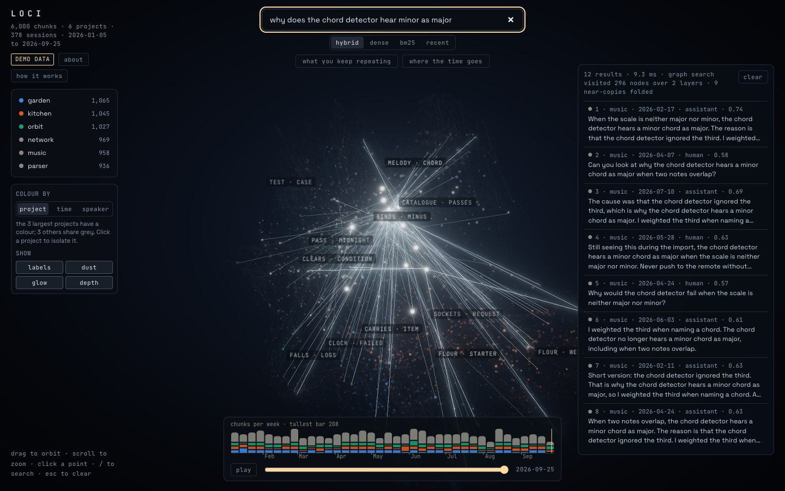

# LOCI

A profiler for how you work with AI. A code profiler shows where a program spends its time; LOCI reads your own AI coding history and shows where your sessions go, what you keep telling your assistant again and again, and whether its own recall of your past work helps.

Underneath it is a local-first memory engine: it indexes the conversations you have already had with a coding assistant, lets an agent search them through MCP, and shows the index as a particle field you can fly through.

Everything runs on your machine. The vector index and the keyword index are written from scratch, and each ships with an oracle that checks it against an exact answer.

The name comes from the method of loci, the memory-palace technique of storing things by placing them in space.

**[Try the live demo](https://ethan-goldstein.github.io/loci/).** It is the viewer and the real search index running in your browser, on invented conversations. Nothing is uploaded.



## What it does

1. **Ingest.** Streams Claude Code session transcripts, and optionally a ChatGPT data export, keeps what you typed and what the assistant said back, and drops the rest (tool output is about 80% of the bytes on disk). Secrets are redacted before anything is stored.
2. **Embed.** Embeds each chunk with a local Ollama model. Resumable: kill it and it continues from the last complete row.
3. **Index.** A from-scratch HNSW graph for meaning and a from-scratch BM25 index for keywords, fused by reciprocal rank.
4. **Prove.** Two differential oracles, a retrieval eval with baselines and confidence intervals, and a preregistered A/B test of whether recalled context improves a model's answers, all written to [RESULTS.md](RESULTS.md) whatever the outcome.
5. **Serve.** A read-only MCP server, so Claude Code (or any MCP client) can recall earlier decisions instead of re-deriving them.
6. **See.** A WebGL viewer where each chunk is a particle, the layout is the index's own neighbour graph, regions are named by their most distinctive words, and a search draws the path it actually took through that graph.
7. **Notice.** Finds the things you told your assistant in several separate sessions and drafts standing rules from them, in your own words, so you can say them once.
8. **Profile.** Counts where your sessions go, from timestamps alone: how many, how long, when in the week, how concentrated, and how much of what you type you had said before.
9. **Fly.** Optional webcam hand control, ported from a gesture-controlled drone project.

## Results

Measured on one corpus (7,692 chunks from 97 sessions) on an Apple M5, single thread, no native code. Full tables and method are in [RESULTS.md](RESULTS.md).

| Question | Result |
|---|---|
| Does the graph find the true nearest neighbours? | 98.1% recall@10 at 0.53 ms in TypeScript and 0.083 ms with the WebAssembly SIMD kernel (exact scan: 3.83 ms and 0.33 ms). 99.6% at 0.90 ms and 0.14 ms. |
| How much does the hand-assembled SIMD kernel buy? | On this corpus 6.4x on graph search and 11.5x on the exact scan, at identical recall, with the same exact top 10 as the TypeScript loop on all 500 queries. On the 128-dimension synthetic set it is 2.3x. |
| Does it hold up at a larger size? | 50,000 synthetic vectors: 99.2% recall@10 at 0.10 ms in TypeScript, 41x faster than its exact scan, and 0.044 ms with the kernel. |
| Does the keyword index agree with SQLite FTS5? | 100% top-10 agreement over 500 real prompts (ties at the cut-off counted as matches). |
| Given only a session's title, does its content come back? | Dense search: top 10 in 86.5% of sessions (chance: 11.4%), top 1 in 66%. |
| Does retrieval beat "the last 10 things I did" at finding same-project work? | **No.** Precision@10 is 0.368 against 0.496 for recency (chance: 0.207). |
| Do near-copies crowd the results, and what does folding them cost? | Rarely here: 0.25 near-copy pairs per top ten. Folding removes them, replaces 0.17 of ten results per query, and costs 0.013 of precision (0.355 against 0.368). Exploratory. |
| Does adding recency as a third signal fix that? | **No.** Precision rises to 0.430, still below recency. First-relevant rank (MRR) is 0.628 against 0.559, which is within the noise. |
| Does context recalled from earlier sessions make a model's answers better? | **Not measurably.** 6.0% correct with it against 3.0% without: +0.030 [-0.007, +0.071] over 268 questions from 67 held-out sessions, judged blind. A gain of 0.10 or more is ruled out. |
| Does that context cost anything? | **Yes.** Wrong answers given instead of "I do not know" rose from 12% to 55%. |
| Can the model use an answer that is already in the store? | 50% correct against 3% without (74% with the passage itself in hand). Biased upward: the questions were written from the stored passages. |
| Where do the sessions go? | 97 sessions on 100 days, about 158 hours of active time. A typical session is 6 prompts and 36 minutes; one in ten runs past 26 prompts. Half of everything is one project. 13.9% of typed sentences repeat an earlier session. |
| How much of what you type is a repeat? | 79 things were said in 3 or more sessions on at least two days, 13.5% of all typed sentences. 1,130 matching cross-session pairs were found where chance would give about 2. |

The negative result is kept on purpose. A recency baseline that ignores the prompt entirely is hard to beat on this corpus, because the last thing you worked on is usually the same project. Hiding project names and file paths from both prompts and corpus changes hybrid precision by 0.000, so the engine is not winning or losing on folder names.

Three caveats on those numbers:

- **The comparison is sensitive to how projects are averaged.** The headline averages over the nine projects with at least 10 queries. That floor was added after two runs a few hours apart disagreed: a new project with a single query moved the every-project average by 0.03 and flipped its verdict, while no other project's score changed. RESULTS.md shows the comparison under three ways of averaging. Hybrid is below recency in all three, and clearly below in one.
- **The recency-fused ranker is post hoc.** It was added after seeing the first result and is scored on the same queries, so its numbers are exploratory. The eval is designed to be re-run on sessions recorded later.
- **Latency is good to about 20%.** Benchmark runs on this machine on different days gave 0.59, 0.67 and 0.50 ms for the TypeScript loop at the same setting. That is why the kernel comparison runs both loops in interleaved rounds on one index and reports the median round: the ratio is steadier than either number.
- **The A/B null is narrow, not flat.** The design, metric and decision rule were [committed before the run](docs/memory-ab-prereg.md), and by that rule the result is a null. A string check that needs no judge puts the same difference at +0.034 [+0.004, +0.071], just clear of zero, and where the answer did exist in earlier sessions (28% of questions) recall added 0.111 [+0.022, +0.207]. Read it as: a few points at most, on this corpus, with a 3B local model doing the writing, answering and judging.

## How it fits together

```
~/.claude/projects/*.jsonl
        │  parse → redact → chunk                       src/ingest
        ▼
~/.loci/loci.db            (chunks, sessions; SQLite)
        │  embed with local Ollama                       src/embed
        ▼
~/.loci/vectors.<model>.f32   (flat float32 rows, append-only)
        │  HNSW + BM25 + reciprocal-rank fusion          src/index, src/search, src/engine.ts
        │  inner loop: WebAssembly SIMD, or TypeScript   src/kernel
        ▼
   ┌────────────┬────────────────────┬──────────────────┐
   │ loci mcp   │ loci serve         │ loci bench / eval │
   │ stdio, MCP │ 127.0.0.1 + viewer │ / ab → RESULTS.md │
   └────────────┴────────────────────┴──────────────────┘
```

The store lives in `~/.loci`, outside any git repository. The CLI refuses to create it inside one.

### The inner loop

A vector search spends nearly all its time in one operation: the dot product of the query with a stored row. `src/kernel/wasm.ts` writes that loop as a 415-byte WebAssembly module using 128-bit SIMD, assembled instruction by instruction in TypeScript. There is no compiler, no extra dependency and no binary file in the repository.

The TypeScript loop it replaces stays, as the fallback and as the oracle the kernel is tested against. Searches use the kernel when the runtime supports it. The graph is always built with the TypeScript loop, and the eval, the A/B test and the repeat-finder use it too, so none of their numbers depends on how a sum was rounded. `LOCI_KERNEL=js` forces the fallback everywhere.

## Quick start

Requires Node 24 or later and [Ollama](https://ollama.com) running locally.

```bash
npm install
```

```bash
ollama pull nomic-embed-text
```

```bash
node src/cli.ts ingest
```

```bash
node src/cli.ts embed
```

```bash
node src/cli.ts search "how did we fix the landing bug"
```

To open the viewer:

```bash
npm run build
```

```bash
node src/cli.ts serve
```

Then open http://127.0.0.1:4319. To try it without any private data, run `node src/cli.ts serve --demo`, which builds a store of invented text and needs no model.

### Adding your ChatGPT history

ChatGPT conversations are not on your disk; you have to ask for them. In ChatGPT, open Settings, then Data controls, then Export data, and confirm. An email arrives with a download link (it expires after 24 hours). Then:

```bash
node src/cli.ts ingest --chatgpt ~/Downloads/your-export.zip
```

```bash
node src/cli.ts embed
```

The path can be the zip, the unzipped folder, or `conversations.json`. Only the conversation JSON is read from the zip; images and the rest of the archive are never extracted. For each conversation the importer follows the branch you ended on (edits and regenerated replies fork the conversation), keeps your prompts and the assistant's prose, and drops system messages, tool calls, tool output and reasoning traces. Everything lands in one project named `ChatGPT`. Re-running with a newer export adds only what is new.

## Commands

| Command | What it does |
|---|---|
| `loci ingest` | Read transcripts, redact, store chunks. Safe to re-run; only new turns are added. `--chatgpt <path>` also imports a ChatGPT export. |
| `loci embed` | Embed chunks that have no vector yet. |
| `loci build` | Build or extend the HNSW index and save it. |
| `loci search <words>` | Search. `--mode hybrid\|dense\|bm25\|recent`, `--project <name>`, `--k`, `--json`. |
| `loci bench` | Measure the index against exact search. |
| `loci eval [--mask]` | Retrieval eval with baselines; `--mask` adds the names-and-paths ablation. |
| `loci ab` | Agent A/B: the same questions answered with and without recalled context, judged blind. Needs a local generative model (`ollama pull llama3.2:3b`) and about an hour with the machine awake; an interrupted run resumes where it stopped. |
| `loci repeats` | Find what you keep telling your assistant across sessions. `--rules` prints draft standing rules, `--min-sessions`, `--z` (how strict "the same thing" is), `--json`. The full list is saved to the private store. |
| `loci profile` | Where your sessions go: counts and durations only, no text. `--tz` sets the time zone for the weekday-and-hour pattern, `--idle` the gap that counts as time away. Saved to the private store. |
| `loci report` | Write RESULTS.md from the last bench, eval, ab, repeats and profile. |
| `loci serve [--demo]` | Start the viewer on 127.0.0.1. |
| `loci mcp` | Run the MCP server on stdio. |
| `loci stats` | Corpus counts. Never prints conversation text. |
| `loci reset --yes` | Delete the store. |

`loci` here means `node src/cli.ts`. Configuration is by environment variable; see [.env.example](.env.example).

## Using it from Claude Code

```bash
claude mcp add loci -- node /absolute/path/to/src/cli.ts mcp
```

The server exposes four tools, all read-only: `search`, `get_thread`, `timeline` and `stats`. The server loads the index when it starts, so restart it after ingesting new sessions.

## The viewer

- **Core points.** Each chunk is one point. Larger points are prompts you typed. A point's position is the data: particles start at a PCA projection of their embeddings and settle into a UMAP-style layout of the HNSW graph's neighbour lists. The simulation runs on the GPU: positions live in a float texture and a fragment shader advances them each frame.
- **Dust.** Each chunk also gets one small point per sentence, scattered around it and slowly orbiting. The number of dust points is real, so longer chunks look denser. Their scatter is decoration and carries no meaning.
- **Edges.** Each chunk is joined to its nearest few neighbours in the index.
- **Region labels.** The settled layout is split into regions with k-means, and each region is named by the words that appear in a large share of its chunks and a small share of everyone else's. They are a reading aid computed from the text, and only as good as the clustering behind them. Click one to fly there.
- **Search path.** A search draws the HNSW trace: every node the search evaluated, from the entry point down through the sparse upper layers and across layer 0. Each line is an edge the search really followed.
- **Colour by** project, time, or speaker. In a scatter any two projects can sit side by side, so every pair of colours has to be distinguishable. Checked with a palette validator across all pairs, only three hues pass under normal vision and simulated red-green colour blindness, so the three largest projects get a colour and the rest share one grey. Click any project in the legend to isolate it. Time uses a single blue ramp from dark (older) to light (newer).
- **Activity chart.** Stacked bars of chunks per week above the time slider, coloured the same way as the field. Hover for the counts, click or drag to move through time. The same numbers are available as a table to screen readers.
- **What you keep repeating.** A panel listing the things you said in several sessions, most widespread first, each with its count, span and kind. Click one to light up every place it was said. It reads the result of `loci repeats`.
- **Glow and depth.** A bloom pass, a tone curve so dense regions keep their colour instead of clipping to white, and per-point depth of field focused on whatever the camera is looking at. Both can be switched off, as can dust and labels; the choices are remembered in the browser.
- **Where the time goes.** A panel of counts taken from timestamps alone: sessions, active hours, a typical session, prompts by weekday and hour, sessions by size, and the weekly share of sentences you had said before. It reads the result of `loci profile`. No text is read to make it, and the weekday-and-hour pattern stays on your machine.
- **How it works.** A guided tour in eight cards that scroll over the map: a point and its neighbours, the sparse upper layers of the graph, a real search replayed first across those layers and then on the bottom one, keyword hits against meaning hits, the most repeated instruction, and what the measured results say. Every number on a card is read from the index or from a search it has just run. Scrolling drives it, and so do the buttons, the step dots and the arrow keys; Esc leaves. `#tour` in the address opens it, and `#q=some+words` opens the page with a search running.
- **Folded results.** Search skips a result that is a near-copy of one already shown and says how many it folded. `loci search --plain` and `diverse=0` on the local API give the plain ranking.
- `/` focuses search, `Esc` clears, click a point to read it.

### Hand control

Local viewer only; the public demo leaves it out. Switch it on with the button at the bottom right. The camera is off until you do, frames are processed in the page, and nothing from the camera is stored or sent.

| Gesture | Effect |
|---|---|
| Open palm, move it | Orbit. The view moves while your palm moves and stops when it rests. |
| Thumb up / victory | Zoom in / out |
| Point | A cursor over the particles; hold on one for 0.9 s to open it |
| Fist | Stop |

The pipeline (tracker → drag anchor → mapper → governor) and its constants are ported from SENTINEL, where they flew a drone: a gesture must hold for three frames before it acts, output ramps instead of jumping, and a lost hand goes to zero after 0.4 s. Hand control needs the gesture model, which is not committed; `npm run assets` copies it in (see [THIRD_PARTY_NOTICES.md](THIRD_PARTY_NOTICES.md)).

## The public demo

The page at https://ethan-goldstein.github.io/loci/ is a static site with no server behind it.

1. `scripts/build-pages.ts` writes 6,000 invented messages about six made-up projects (`src/prove/prose.ts`), runs them through the real ingest, index and export code, and saves the result as static files: the vectors, the HNSW graph in its own file format, and the viewer's buffers.
2. The page loads those files and runs the engine itself. The ranking code (`src/search/core.ts`), the HNSW search, BM25 and the rank fusion are the same modules the local server and the MCP server use, compiled for the browser. A search you type is embedded, walked through the graph and fused in the page.
3. The one difference from a real install is the embedder. A real install uses a language model through Ollama. The demo uses a small bag-of-words hashing embedder (`src/prove/hash-embed.ts`), so it needs no model and no network. It finds texts that share vocabulary, not paraphrases, so the demo says nothing about retrieval quality on real history. Those numbers are in [RESULTS.md](RESULTS.md).

Eight habits were planted in the invented text. The repeat-finder has to find them, and it lists them first, followed by a few accidental near-matches that a small invented vocabulary produces.

The demo build leaves out hand control: it ships no camera code, no WebAssembly and no gesture model. Its Content-Security-Policy allows nothing but the site's own files, and a test checks that the page makes no request to anywhere else.

```bash
npm run build:pages
```

```bash
npm run test:e2e:pages
```

The first builds the demo into `dist-pages/`. The second serves it from a sub-path, the way GitHub Pages does, and runs the browser tests against it. CI does both on every push and deploys `main`.

## Security and privacy

- **Nothing leaves the machine.** Embedding uses a local model, and the configured endpoint must be a loopback address or the CLI refuses to start. The A/B test generates, answers and judges through the same endpoint. Its questions and answers are derived from your conversations, so they are written only to the private store; the terminal and RESULTS.md get counts and scores.
- **Redaction happens first.** Credential formats, values next to secret-looking names, URL credentials, private keys, JWTs, high-entropy runs, emails, phone numbers and home-directory paths are replaced before text is hashed, stored, embedded or served. A fuzz test generates secrets of every family and checks none survive; another scans the raw database files for seeded secrets. Redaction is best-effort: a secret that looks like an ordinary word will pass.
- **The viewer's server** binds 127.0.0.1 only, checks Host and Origin (so a web page elsewhere cannot reach it through your browser), accepts GET and HEAD only, validates every parameter, confines static files to the build directory, and sends a strict Content-Security-Policy.
- **Recalled text is untrusted.** Old conversations can contain instructions someone once pasted in. The MCP server wraps everything it returns in a labelled block, escapes that block's delimiter inside the text, and marks every tool read-only. The viewer writes conversation text with `textContent`, never as HTML; an end-to-end test injects markup and confirms it stays text.
- **No private data in the repo, CI or the public demo.** Tests and the demo run on invented text. `npm run guard` fails if a database, vector or index file is ever tracked. The demo's data is built in a temporary directory by a script that never reads the private store.

## Tests

```bash
npm test
```

```bash
npm run test:e2e
```

198 unit tests and 19 end-to-end tests: 10 against the local viewer and 9 against the public demo build. The ones that matter most:

- **HNSW against brute force:** recall thresholds, determinism for a seed, incremental extension producing the same graph as a one-shot build, file-format round trip, rejection of corrupt files, filtered search against a filtered oracle, and a check that every step of a recorded trace starts from a node already reached.
- **The SIMD kernel against the TypeScript loop it replaces:** agreement at seventeen vector lengths including every remainder case, the same graph bytes with or without it, the same neighbours exactly and through the graph, and a clean fallback when WebAssembly is missing.
- **Folding near-copies:** planted copies are folded, the top result never changes, nothing is promoted from far down the ranking, and with folding off the ranking is exactly what it was.
- **Session profile:** a hand-built history with known answers, and a check that no project name or hour-of-day pattern can reach RESULTS.md.
- **BM25 against FTS5:** scores equal to four decimal places and top-10 agreement on generated queries.
- **Graph layout:** neighbours end up close, the clusters the data was drawn from separate, and the result is deterministic.
- **Region labels:** k-means recovers separated groups, and labels on synthetic topics are made only of topic words.
- **Redaction fuzz** across twenty secret families, 200 seeds each.
- **The eval harness itself:** a positive control on synthetic data where retrieval should clearly beat recency (and the harness says it does), the closed-form random baseline checked against simulation, and a check that a mixed result is never worded as a win or a loss.
- **ChatGPT import:** conversation branches, dropped tool and system messages, zip extraction limited to the conversation JSON, and redaction of a seeded key.
- **Gesture pipeline:** the mapper, drag-anchor and debounce tests ported from SENTINEL.
- **A/B harness** on the synthetic store with a fake model: the memory arm never sees the held-out session or anything dated after it began, the judge receives only question, reference and answer, a planted effect is detected, and each branch of the decision rule gives the verdict it should.
- **Public demo:** served from a sub-path with no server behind it, it must make no request to anything but its own files, compile no WebAssembly, answer every ranking mode in the page, lead its repeats with the planted habits, and fit a phone screen.
- **Guided tour:** every card reachable by keyboard, by its dots and by a real scroll, each one lighting what it describes; it fits a phone, works with reduced motion, and leaves the viewer as it found it. A unit test checks that every result quoted on its last card appears in RESULTS.md.
- **Repeat-finder:** a hand-built store where one habit must be found and one-session emphasis, a same-day burst and a program's template must all be left out; a threshold that is not dragged up by the repeats themselves; and recovery of the instructions planted in the demo data.

## What this does not show

- "Same project" is a coarse relevance label. It shows the engine finds the right neighbourhood, not the passage that answers a prompt.
- One person, one corpus, one embedding model.
- The A/B test used one small local model to write the questions, answer them and judge the answers, and its no-context arm had no tools and no repository. Whether a stronger agent that can also read the code gains from recall is untested.
- The repeat-finder counts repetition; it does not show that each repeat was needed or that a standing rule would have prevented it. Its kind labels come from word patterns, and a few program-written prompts can still slip through as if typed.
- The index is single-threaded, and the kernel speeds up the inner loop only: vectors are full 32-bit floats, nothing is quantised, and the graph is still built with the TypeScript loop. The kernel was measured on one machine.
- Folding was added after the first retrieval results were seen, and the same-project label can only price it, never reward it. Whether a folded list is more useful to a person or an agent is not measured.
- The session profile counts time between messages. It says nothing about what that time produced.
- The viewer and the public demo are tested in headless Chromium with a software renderer, at desktop and phone sizes. Frame rate on a range of real GPUs and behaviour on a physical phone have not been measured. Hand control is covered by unit tests of its logic, not by a test with a real hand.
- Claude Code transcripts and ChatGPT exports are the only sources ingested today. The ChatGPT importer is tested on synthetic exports in the documented format, not yet on a real one.

## Licence

MIT. Third-party components are listed in [THIRD_PARTY_NOTICES.md](THIRD_PARTY_NOTICES.md).
